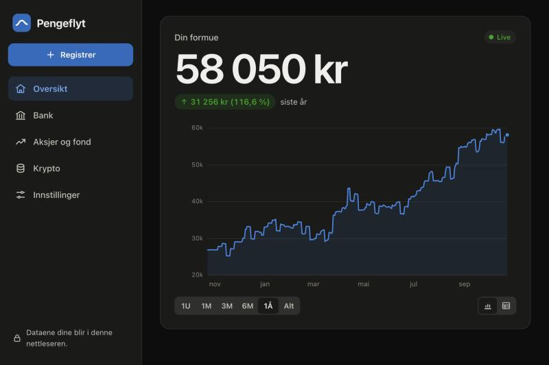
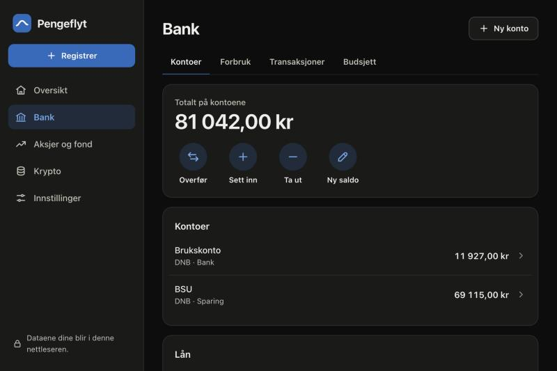
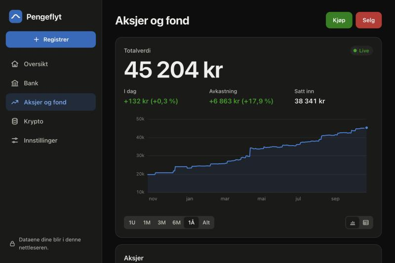
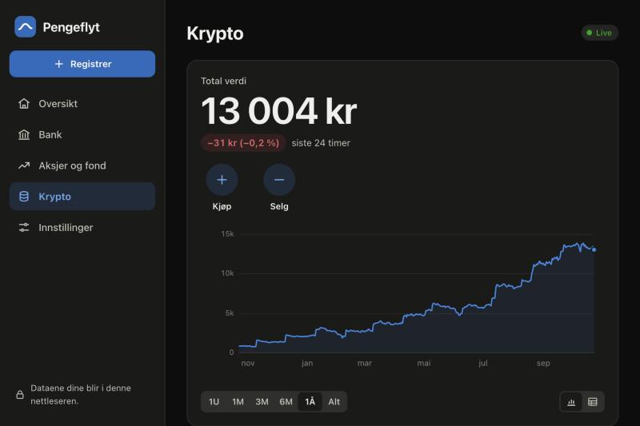
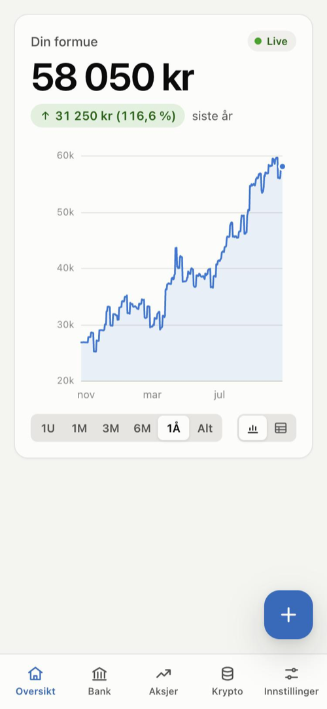
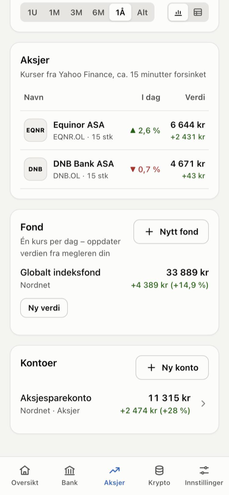
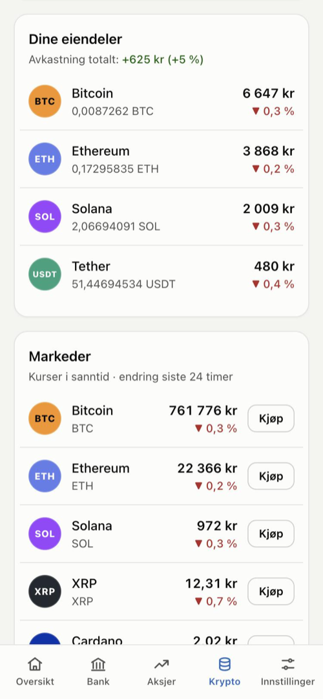

# Pengeflyt – formue og forbruk på ett sted

**▶ Prøv appen: [murtaza1701.github.io/finance-tracker](https://murtaza1701.github.io/finance-tracker/)** –
trykk **Prøv med eksempeldata** for å se den med et år med data.

**Pengeflyt** samler hele formuen din på ett sted: bankkontoer, sparing og BSU, fond, aksjer, krypto
(f.eks. Firi og Binance) og gjeld som studielån. Kryptoverdiene følger markedet **i sanntid** og aksjene
følger kursene på børsen (ca. 15 minutter forsinket), og når du
setter inn eller tar ut penger, oppdateres totalen med en gang. Appen viser også hvordan formuen har
utviklet seg over tid og hvor mye avkastning fond, aksjer og krypto har gitt. I tillegg kan du følge
forbruket ditt måned for måned og sette budsjetter per kategori.

Appen har fire hovedsider: **Oversikt** (formuen, en graf og summen for hver side), **Bank**, **Aksjer og fond**
og **Krypto**.
Oppsettet er inspirert av hvordan en nettbank (som DNB), en aksjemegler (som Nordnet) og en kryptobørs (som
Firi og Binance) viser kontoene dine, men appen har egne farger og bruker ingen logoer eller kode fra dem.

Appen kjører helt i nettleseren. Det finnes ingen konto, innlogging eller server, og dataene dine forlater
aldri maskinen (de lagres i nettleserens `localStorage`). Bare kurser hentes fra nettet.

> Laget i Oppgave 3 i *Intro til KI* (vibe coding): appen er planlagt, skrevet, testet og forbedret sammen
> med en KI-kodeagent.

## Skjermbilder

| Oversikt | Bank |
|---|---|
|  |  |
| **Aksjer og fond** | **Krypto** |
|  |  |

På mobil (lyst tema): forsiden, aksjene og fondene, og kryptoeiendelene med markedslisten.

<p>
  
  
  
</p>

*Skjermbildene viser eksempeldataene i appen, ikke ekte kontoer.*

## Funksjoner

**1. Oversikt (forsiden)**
- Nettoformuen (eiendeler minus gjeld) og en graf over hvordan den har beveget seg
- Velg periode (1 uke, 1 måned, 3 måneder, 6 måneder, 1 år eller alt) og se endringen i kroner og prosent;
  grafen kan også vises som tabell
- Summen for **Bank**, **Aksjer og fond** og **Krypto** under grafen, med lån og endringen i dag, så du
  raskt ser hvor pengene ligger; trykk på en av dem for å gå til siden

**2. Bank** – bygd opp som en nettbank
- Totalt på kontoene, med snarveier for **Overfør**, **Sett inn**, **Ta ut** og **Ny saldo**
- Kontoene, lånene og de siste bevegelsene, gruppert per dag
- Faner for **Forbruk**, **Transaksjoner** og **Budsjett** (se under)

**3. Aksjer og fond** – bygd opp som hos en aksjemegler
- Totalverdi, endring i dag, avkastning og hvor mye du har satt inn, med graf
- Beholdningen som tabell: antall, snittkurs (GAV), siste kurs, endring i dag, verdi og avkastning
- Fond med egen «Ny verdi»-knapp (fond har bare én kurs per dag), og **Kjøp**/**Selg** øverst

**4. Krypto** – bygd opp som en kryptobørs
- Total verdi i sanntid og endringen siste 24 timer, med **Kjøp**/**Selg** og graf
- Myntene dine med verdi og døgnendring, og en markedsliste med alle myntene og en kjøpsknapp

**Kontosider** – én side per konto med verdi, beholdning, graf og alle bevegelser

**Innskudd, uttak og overføringer**
- Registrer innskudd, uttak eller ny saldo/verdi med et par trykk; totalen oppdateres med en gang
- Kjøp og salg av krypto og aksjer: skriv antall *eller* beløp, så regner appen ut det andre med kursen
- **Overfør** mellom egne kontoer (fra konto, til konto, beløp), eller velg «Pengene kom fra Brukskonto»
  ved et innskudd: beløpet trekkes fra den andre kontoen, så formuen ikke telles dobbelt
- Du kan ikke selge flere mynter enn du har, og alt kan slettes og angres (<kbd>Ctrl</kbd>/<kbd>⌘</kbd>+<kbd>Z</kbd>)

**Live kurser for krypto og aksjer**
- Krypto: ny pris hvert sekund fra Binance (WebSocket), regnet om til kroner med kursen fra CoinGecko
- Aksjer: kurser fra Yahoo Finance hvert minutt (ca. 15 min forsinket), via en liten Cloudflare Worker
  (se [cloudflare/](cloudflare/README.md)). Søk på navnet («Equinor») og velg fra listen; utenlandske aksjer
  regnes om til kroner (f.eks. Apple fra USD)
- Tallene som endres, blinker kort grønt eller rødt, og et «Live»-merke viser at strømmen er aktiv
- Historiske dagskurser brukes i grafen, så verdien bakover i tid blir riktig
- Ingen innlogging eller API-nøkler: appen spør bare om kurser, aldri om hva du eier

**Forbruk og budsjett** (fra første versjon av appen, nå som faner under Bank)
- Inntekter og utgifter med kategorier, søk, filtre og CSV-eksport (semikolon og desimalkomma for norsk Excel)
- Månedlige budsjetter som varsler ved 80 % og viser hvor mye du kan bruke per dag resten av måneden
- «Foreslå budsjetter» ut fra hva du har brukt de siste tre månedene

**Ellers**
- Eksempeldata: et år med kontoer for en student i Norge, med ekte historiske kurser for krypto og aksjer
- Sikkerhetskopi og gjenoppretting (JSON), og sletting av alt (med angre)
- Fungerer på mobil (fanelinje nederst, dialoger som bunnark) og PC, i lyst og mørkt tema

## Kom i gang

Du trenger bare Python 3 (følger med macOS; på Windows fra python.org). Ingenting må installeres.

```bash
python3 serve.py
```

Åpne **http://localhost:8000** og trykk **Prøv med eksempeldata**, eller legg inn dine egne kontoer.

Hvorfor en server? Nettlesere nekter å laste JavaScript-moduler fra en side som er åpnet som fil (`file://`).
Dobbeltklikker du `index.html`, får du en melding som forklarer hvordan appen startes.

## Tester

118 enhetstester dekker beregningene, tolkning av tall, lagring, overføringer, kurser og eksport.

- **På nettsiden:** åpne **https://murtaza1701.github.io/finance-tracker/tests/** (testene bruker ikke
  dataene dine)
- **I nettleseren lokalt:** start serveren og åpne **http://localhost:8000/tests/**
- **I terminalen på Mac** (med JavaScript-motoren som følger med macOS):
  ```bash
  /System/Library/Frameworks/JavaScriptCore.framework/Versions/Current/Helpers/jsc -m tests/cli.js
  ```

Se [Testing](#testing) for hva som ble testet for hånd, og feilene testingen fant.

## Publisering med GitHub Pages

Appen ligger ute på **https://murtaza1701.github.io/finance-tracker/**. Den er bare statiske filer, så
GitHub Pages kan vise den gratis. Slik publiserer du en egen kopi:

1. Lag et nytt, offentlig repository på GitHub og push denne mappen dit.
2. Gå til **Settings → Pages**, velg **Deploy from a branch**, `main` og `/ (root)`, og lagre.
3. Etter et minutt ligger appen på `https://<brukernavn>.github.io/<repository>/`.

## Slik er appen bygget

Vanlig HTML, CSS og JavaScript (ES-moduler) – ingen rammeverk, ingen byggesteg og ingen avhengigheter.

```
index.html            sideskall: meny og dialoger
styles.css            all stil, lyst/mørkt tema og mobilvisning
serve.py              liten lokal webserver
cloudflare/worker.js  Cloudflare Worker som henter aksjekurser fra Yahoo (med oppsett i cloudflare/README.md)
src/
  app.js              startpunkt: ruting (#/oversikt, #/bank …), tegning av sider, knapper og kursstrøm
  store.js            dataene: kontoer, bevegelser, transaksjoner, budsjetter; sjekk og lagring
  networth.js         formueberegninger: saldo fra bevegelser, avkastning, formue dag for dag
  prices.js           kurser: Binance (sanntid), CoinGecko (krypto i kroner, historikk), Yahoo via Workeren (aksjer)
  accounts.js         kontotyper, hvilken side (Bank, Aksjer og fond, Krypto) de hører til, og kryptovalutaer
  finance.js          forbruksberegninger: måneder, kategorier, budsjetter, forslag
  money.js, dates.js  tall, kroner og datoer på norsk
  charts.js           linjegraf, søylediagram, kategorilinjer og budsjettlinjer
  dialogs.js          dialogene for konto, bevegelse, transaksjon og budsjett
  demo.js             eksempeldata
  csv.js, html.js     CSV-eksport og trygge HTML-maler
  views/              én fil per side (overview, bank, investments, crypto, account, spending …),
                      history.js (grafen med periodevalg) og live.js (oppdaterer tall når kursene endres)
tests/                enhetstester og en liten testkjører
docs/skjermbilder/    skjermbildene i denne README-en
```

Noen valg som er tatt:
- **Saldoen regnes ut fra bevegelsene** (startsaldo, innskudd, uttak, ny verdi, kjøp, salg) i stedet for å
  lagres som ett tall. Da stemmer alt også etter sletting og angring, og formuen kan regnes ut for hver dag
  bakover i tid.
- **Penger lagres i øre (heltall)**: `1 234,50 kr` lagres som `123450`, fordi desimaltall ikke summeres
  nøyaktig i JavaScript (`0.1 + 0.2 = 0.30000000000000004`).
- **Live-tall oppdateres uten å tegne siden på nytt**, så åpne lister, verktøytips og markøren ikke
  forstyrres hvert sekund.
- **Ingen hemmeligheter i koden.** Automatisk henting av saldo fra bank (krever lisensiert PSD2-aktør og
  BankID) og fra Binance/Firi (krever API-nøkler som må holdes hemmelige) ble bevisst valgt bort; åpne
  kursdata gir sanntid uten nøkler.
- **Aksjekurser via egen Worker.** Yahoo Finance tillater ikke at nettsider leser kursene direkte (de sender
  ingen CORS-tillatelse), men en server kan. Workeren hos Cloudflare er en gratis mellomstasjon som bare
  slipper gjennom til denne appen. Aksjer og mynter lagres med ulike nøkler (`aksje:EQNR.OL` og `BTC`),
  så en ticker aldri blandes med en mynt med samme navn.
- **Alt brukeren skriver blir «escapet»** før det vises (`src/html.js`), og CSV-eksporten hindrer at
  regneark kjører tekst som formler.
- **Fargene i grafene** er sjekket for kontrast og fargeblindhet, og status vises aldri bare med farge
  (alltid også ikon, pil eller ord).

## Testing

**Automatisk:** 118 enhetstester (`tests/`) for blant annet tolkning av beløp og antall, norsk tallformat,
datoer over måneds- og årsskifter, saldo fra bevegelser, avkastning, snittkurs (GAV), endring i dag,
formue dag for dag med historiske kurser, overføringer (begge sider, sletting og angring), salg av flere
mynter enn man har, tolkning av svar fra CoinGecko og Binance, budsjetter, lagring (også ødelagte data og
full lagring), sikkerhetskopier, CSV-eksport og eksempeldata.

**For hånd i nettleseren** (PC og mobil 375 px, lyst og mørkt tema):

| Testet | Resultat |
|---|---|
| Ny bankkonto med startsaldo; ny kryptokonto med 0,01 BTC uten oppgitt pris (bruker dagens kurs) | ✅ |
| «Live»-merket og verdier som oppdateres fra Binance-strømmen | ✅ |
| Nytt fond med innskutt beløp; innskudd «fra Brukskonto» trekker fra banken; avkastning +10 % stemmer | ✅ |
| Kjøp av ny mynt (ETH) for 500 kr: antall regnes ut fra live-kursen | ✅ |
| Salg av mer BTC enn kontoen har gir feilmelding | ✅ |
| Sletting av bevegelse og angring | ✅ |
| Eksempeldata med ekte historiske kurser; graf med 366 dager og avkastning | ✅ |
| Aksjer: søk «apple» → Apple (NASDAQ), kurs regnet om fra USD; 2 aksjer gir riktig beløp | ✅ |
| Ny aksjekonto: søk «kongsberg» → KOG.OL, første kjøp til dagens kurs | ✅ |
| Kjøp av en ticker som ikke finnes, gir feilmelding | ✅ |
| Forbruk, transaksjoner, budsjett og innstillinger på norsk | ✅ |
| Ingen side kan rulles sidelengs på mobil; dialogene vises som bunnark | ✅ |
| Ny forside: bare formuen og grafen, periodevalg og tabellvisning | ✅ |
| Bank: «Overfør» 1 500 kr fra Brukskonto til BSU flytter pengene, totalen står stille, og angre fjerner begge sider | ✅ |
| Aksjer og fond: «Kjøp» åpner aksjekontoen med aksjesøk; tabellen og fondene passer på 375 px | ✅ |
| Krypto: «Kjøp» i markedslisten åpner riktig mynt; kjøp av XRP for 200 kr regner ut antallet | ✅ |
| Fanene under Bank og «Tilbake»-lenkene på kontosidene går til riktig side | ✅ |
| Forsiden: Bank + Aksjer og fond + Krypto − lån går opp i formuen, og flisene lenker til riktig side | ✅ |

**Feil som ble funnet under testing og gjennomgang (alle rettet):**

1. En kryptokonto opprettet uten «Betalt» fikk **0 kr som kjøpspris** fordi kursen ikke var hentet ennå –
   da ville hele verdien vist som gevinst. Nå hentes kursen før lagring.
2. **«Live»-merket dukket aldri opp** første gang en mynt ble lagt til, fordi kursstrømmen fortsatt sto som
   «inaktiv» da siden ble tegnet.
3. Live-oppdateringen ville **snudd fortegnet på gjelden** i oversikten (funnet ved gjennomgang).
4. Dialogene kunne gått i **løkke** hvis kurshentingen feilet (funnet ved gjennomgang).
5. Blinkingen ved kursendringer var **for kraftig** (hele blokker ble farget); nå blinker bare tallet.
6. Beholdningstabellen måtte rulles sidelengs på mobil; nå viser mobilen færre kolonner.

Fra de nye sidene:
7. **Dialogen husket motkontoen** fra forrige gang: etter en overføring til BSU ville et kryptokjøp blitt
   trukket fra BSU-kontoen. Nå nullstilles den hver gang dialogen åpnes.
8. **«I dag» på aksjesiden** ble regnet i prosent av bare aksjene, ikke hele porteføljen med fondet
   (+1 % i stedet for +0,2 %).
9. **Den flytende +-knappen dekket knapper** på mobil (f.eks. «Kjøp» i markedslisten); den vises ikke
   lenger på sider som har egne knapper.
10. Eksempeldataene ga **store hopp i grafen** fordi studielånet økte 17 500 kr to ganger i året; nå øker
    det litt hver måned, som utbetalingene fra Lånekassen.

Fra første versjon:
11. **Slett**-knappen synlig i «ny transaksjon» (CSS overstyrte `hidden`).
12. **Negative beløp ble rundet annerledes** (`Math.round(-1234.5)` er `-1234`); nå finnes en test for det.
13. Ved **redigering ble nytt beløp lagt til bak det gamle**; nå markeres beløpet når dialogen åpnes.
14. **Dialogen var bredere enn mobilskjermen** (standardbredden til et `<input>`).
15. **Den lokale serveren hang ved oppstart** på enkelte nettverk (navneoppslag i Python).
